# ha-home-connect-card

[](https://github.com/hacs/integration)
[](https://github.com/juju35/ha-home-connect-card/actions/workflows/hacs.yml)
[](https://github.com/juju35/ha-home-connect-card/actions/workflows/validate.yml)
[](https://github.com/juju35/ha-home-connect-card/releases/latest)
[](LICENSE)

Custom Lovelace cards for Home Assistant's [Home Connect](https://www.home-assistant.io/integrations/home_connect/) integration (Bosch, Siemens, Neff, Gaggenau): **one card per appliance type**, a dishwasher card and a washing machine card.

Pick the appliance, the card finds all its entities by itself.

[](https://my.home-assistant.io/redirect/hacs_repository/?owner=juju35&repository=ha-home-connect-card&category=plugin)

| Dishwasher | Washing machine |
|---|---|
|  |  |

## Features

- Two cards: `home-connect-dishwasher-card` and `home-connect-washer-card`, plus their mini versions `home-connect-dishwasher-mini-card` and `home-connect-washer-mini-card` (compact, a detail button unfolds the full card)
- Automatic entity discovery from the Home Connect device (works with English or French entity IDs), each entity can be overridden
- Status with color, progress bar, finish time and time left
- Program picker and **Start** button (when remote start is enabled on the appliance), **Pause / Resume** for washers, **Stop** with a confirmation tap
- Program options before starting: temperature, spin speed, Vario Perfect for washers; intensive zone, brilliance dry, speed perfect, hygiene plus for dishwashers… whatever your appliance exposes. Options the selected program doesn't support are greyed out
- Door state, salt and rinse aid alerts
- Visual editor in the dashboard UI (no YAML needed)
- English and French, follows the Home Assistant language
- Light and dark theme compatible
- Single file, no dependencies, HACS-ready

## Prerequisites

- Home Assistant 2024.8 or later with the [Home Connect](https://www.home-assistant.io/integrations/home_connect/) integration set up
- To start a program from Home Assistant, **Remote start** must be enabled on the appliance itself (the card shows a hint when it isn't)

## Installation

### Via HACS (recommended)

Click the button below to add the repository directly:

[](https://my.home-assistant.io/redirect/hacs_repository/?owner=juju35&repository=ha-home-connect-card&category=plugin)

Or manually:

1. Open HACS → **⋮** → **Custom repositories**
2. Add `https://github.com/juju35/ha-home-connect-card` — Type: **Dashboard**
3. Search for **Home Connect Card** and install it
4. Clear your browser cache and refresh

HACS registers the dashboard resource for you.

### Manual

1. Download `home-connect-card.js` from the [latest release](https://github.com/juju35/ha-home-connect-card/releases/latest)
2. Copy it to `/config/www/home-connect-card.js`
3. Go to **Settings → Dashboards → Resources** → Add resource:
   - URL: `/local/home-connect-card.js`
   - Type: **JavaScript Module**
4. Clear your browser cache and refresh

## Configuration

### Visual editor

Add the card from the dashboard (**Add card** → **Home Connect Dishwasher Card** or **Home Connect Washer Card**). The first matching appliance is picked automatically; change it with the **Appliance** field, then set the name, icon and the sections to show. The **Entities (advanced)** panel lets you force any entity if auto-detection picks the wrong one. Options left at their default are not written to the YAML.

### Minimal

```yaml
type: custom:home-connect-dishwasher-card
device_id: bad11e7fd00845a2fb485b38c97cf675
```

```yaml
type: custom:home-connect-washer-card
entity: sensor.washing_machine_operation_state
```

### Mini cards

```yaml
type: custom:home-connect-washer-mini-card
```

The mini card shows the appliance, its state, the program, the progress and finish time, the alerts, and round Start / Pause / Resume and power buttons. The detail button (top right) unfolds the full card with every option; a click anywhere else on the page folds it back. It takes the same options as the full card, which apply once unfolded, plus `zoom`.

Use either `device_id` (what the visual editor writes) or `entity` (any entity of the appliance). With neither, the card uses the first dishwasher / washing machine it finds.

### Full options

```yaml
type: custom:home-connect-washer-card
device_id: 5c3a4c7f80e0aa935477ebca6e7b915b
name: Washing machine
show_program: true
show_options: true
show_controls: true
show_alerts: true
show_power: true
show_logo: true
language: en
entities:
  operation_state: sensor.washing_machine_operation_state
  selected_program: select.washing_machine_selected_program
  active_program: select.washing_machine_active_program
```

### Options reference

| Option | Required | Default | Description |
|---|---|---|---|
| `device_id` | ❌* | Auto | Home Connect device (*or `entity`; the first matching appliance is used if both are missing) |
| `entity` | ❌ | — | Any entity of the appliance, used to find the device |
| `name` | ❌ | Device name | Card title |
| `icon` | ❌ | Illustration | Replaces the appliance illustration with an icon |
| `show_program` | ❌ | `true` | Show the program picker |
| `show_options` | ❌ | `true` | Show program options (only before a program starts) |
| `show_controls` | ❌ | `true` | Show Start / Pause / Resume / Stop buttons |
| `show_alerts` | ❌ | `true` | Show salt and rinse aid alerts |
| `show_power` | ❌ | `true` | Show the power button (turn off for appliances that can't be switched on / off remotely) |
| `show_logo` | ❌ | `true` | Show the Home Connect logo in the header |
| `zoom` | ❌ | `true` | Mini cards only: detail button at the top right that unfolds the full card (a click elsewhere folds it back) |
| `language` | ❌ | Auto | Force language: `fr` or `en` (auto-detects from HA settings) |
| `entities` | ❌ | Auto | Override detected entities (see below) |

### Entity overrides

Keys accepted under `entities`:

| Key | Domain | Used for |
|---|---|---|
| `operation_state` | `sensor` | Status (ready, running, finished…) |
| `door` | `sensor` | Door chip |
| `progress` | `sensor` | Progress bar |
| `finish_time` | `sensor` | Finish time and time left |
| `selected_program` | `select` | Program picker |
| `active_program` | `select` | Running program, and Start |
| `power` | `switch` | Power button |
| `stop` | `button` | Stop |
| `pause` / `resume` | `button` | Pause / Resume (washers) |
| `remote_start` | `binary_sensor` | Enables the Start button |
| `remote_control` | `binary_sensor` | Detects a program being set on the appliance itself |
| `connectivity` | `binary_sensor` | Online / offline state |
| `salt` / `rinse_aid` | `sensor` | Salt and rinse aid alerts (dishwashers) |

Every other `switch` and `select` of the device is shown as a program option.

## Screenshots

While a program runs the illustration comes alive, and each appliance animates differently (the card honours `prefers-reduced-motion` and falls back to a still image).

A dishwasher mid-cycle sprays water across the tub, lets steam curl off the top and glows a pool of light on the floor while its status light blinks and the progress bar fills:

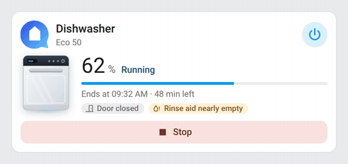

A washing machine mid-cycle turns its drum, sloshes the water behind the porthole and lifts a few suds as the whole body gently shakes:

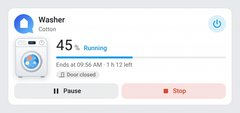

When a cycle finishes the motion stops, a tick is drawn into the badge and sparkles twinkle around the appliance:

| Dishwasher | Washing machine |
|---|---|
| 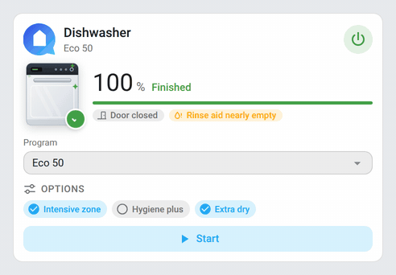 | 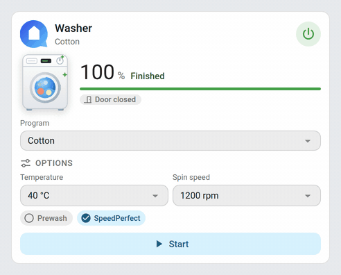 |

Paused mid-cycle, the program badge breathes in and out so the pause reads at a glance (the washer offers Resume):

| Dishwasher | Washing machine |
|---|---|
| 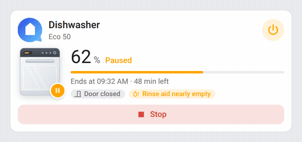 | 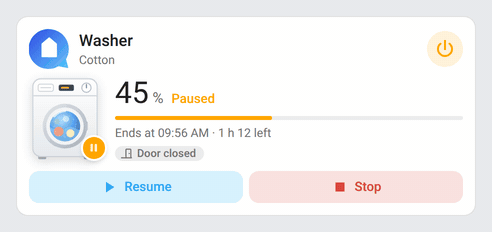 |

Waiting on a delayed start, the badge becomes a little clock whose hands turn until the program begins:

| Dishwasher | Washing machine |
|---|---|
| 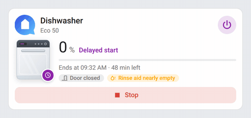 | 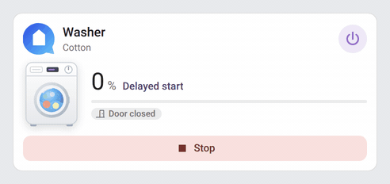 |

| Dishwasher | Washing machine |
|---|---|
| 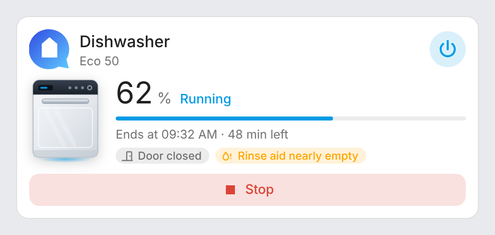 | 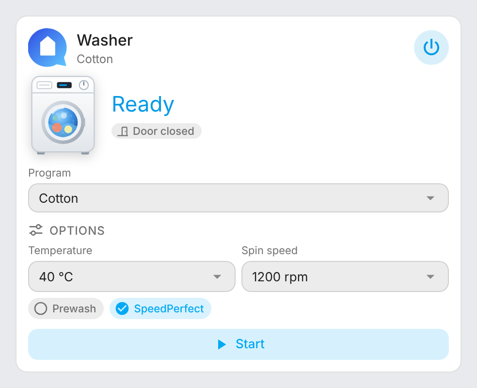 |
| 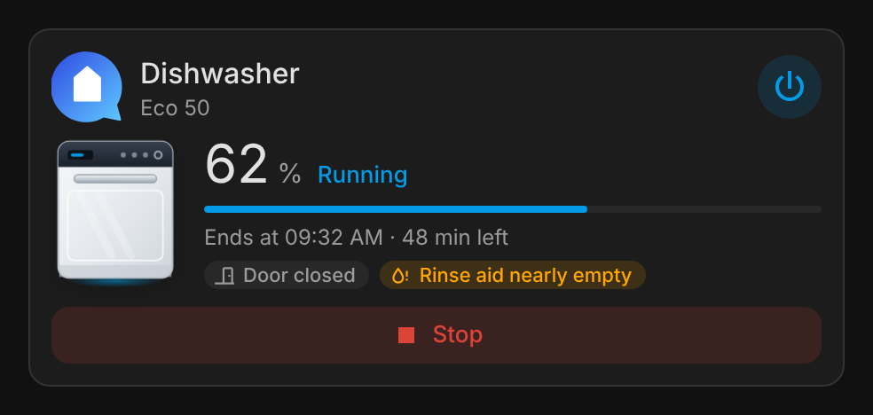 | 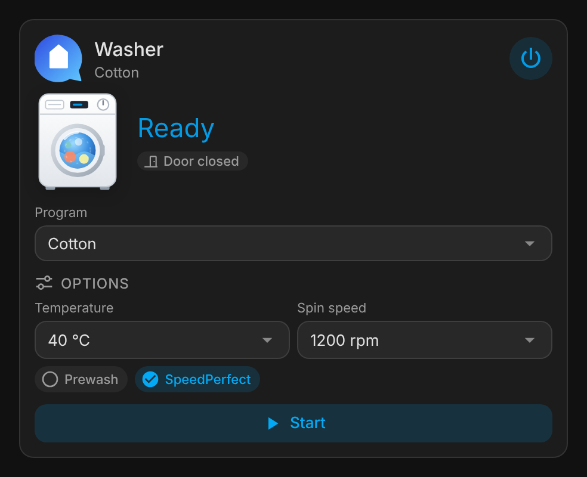 |
| 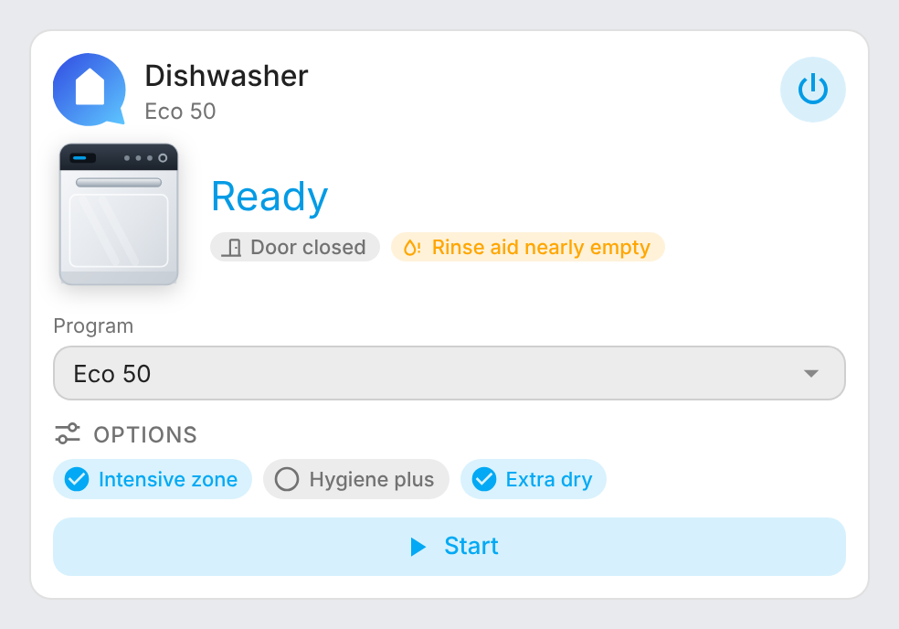 | 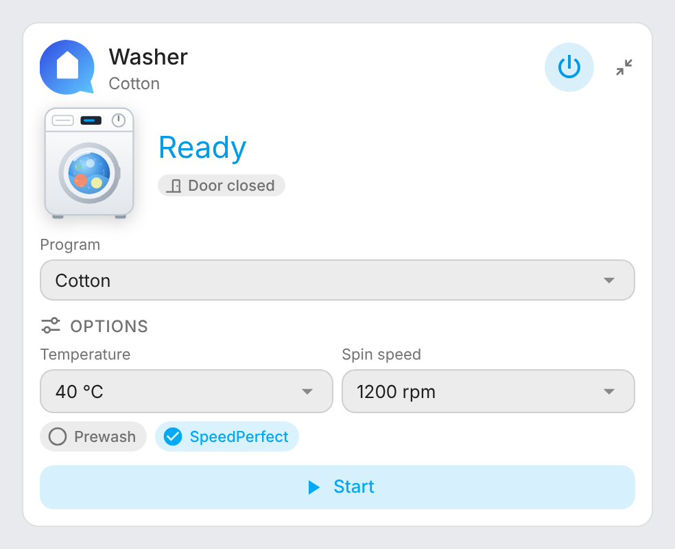 |
| 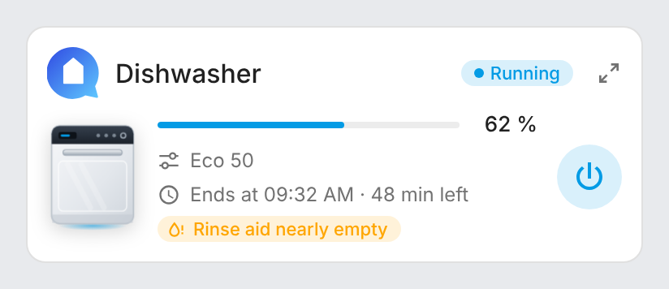 | 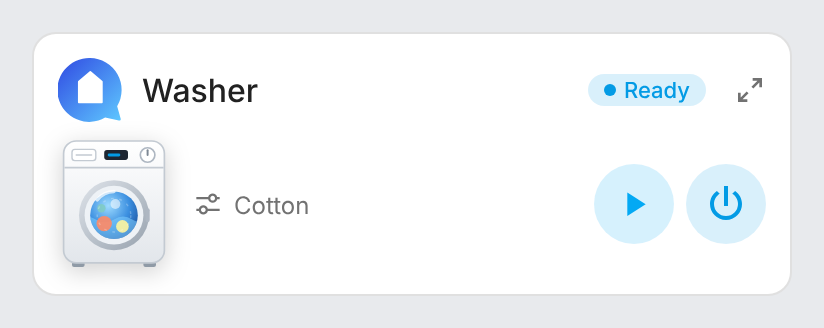 |
| 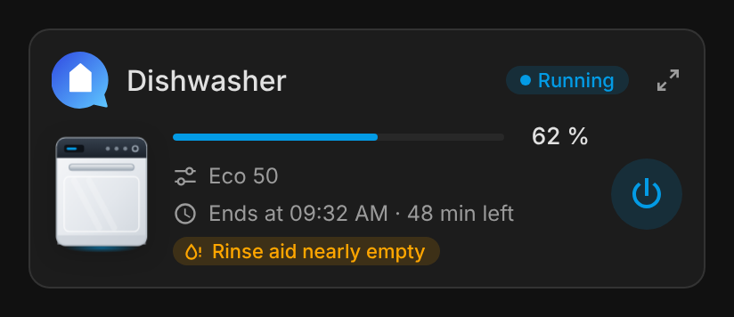 | |

Door open — the dishwasher's door lowered on its racks, the washing machine's porthole swung aside:

| Dishwasher | Washing machine |
|---|---|
| 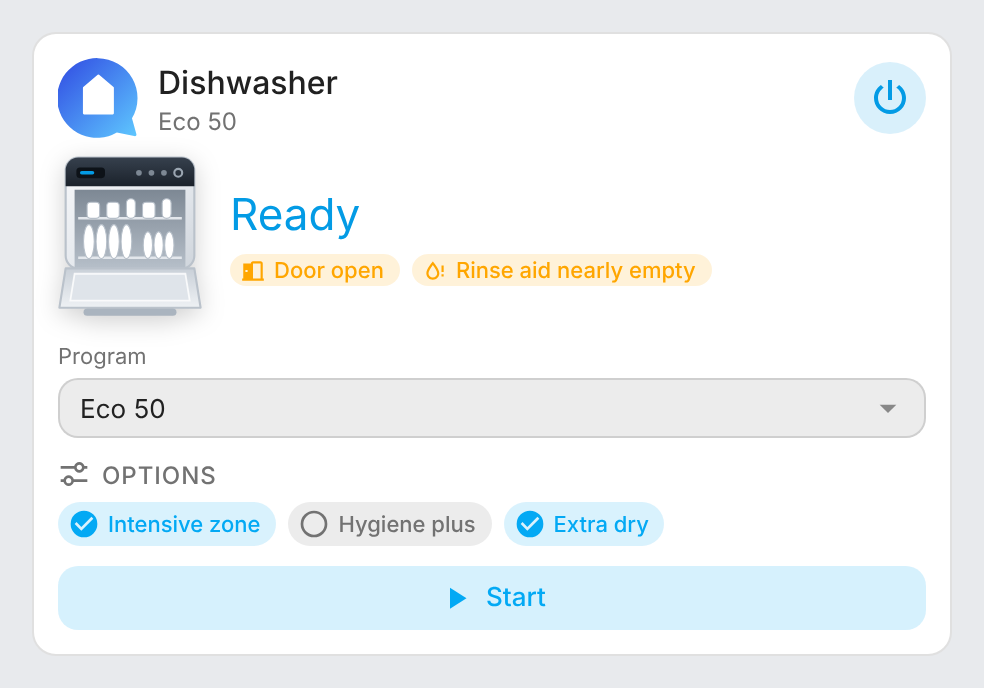 | 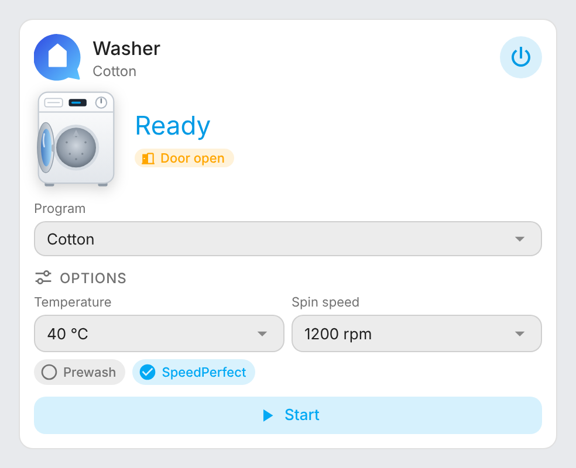 |

## How it works

The card reads the entity registry to list the entities of the chosen device, then matches each role by its translation key, then by its entity ID (English and French slugs), then by its attributes. Program and option labels use Home Assistant's own translations.

Home Connect only sends program options when the selected program changes, so after a Home Assistant restart they all stay unavailable. The card then shows them greyed out with a **Load options** button, which switches to another program and back to load them. While someone turns the dial on the appliance (*Remote control* off), Home Assistant can't read the options: the card says so and disables the button until remote control is back. It never reloads them by itself, since that changes the program on the appliance. If loading fails, the original program is restored.

**Start** selects the chosen program on the *Active program* entity, which is how the Home Connect integration starts a program. Appliances sometimes reject a start for a moment (`BadRequest`, `WrongOperationState`): the card then retries once after 3 seconds, and if it fails again shows a short message in the card instead of Home Assistant's raw error (the technical detail is in its tooltip). **Stop** asks for a second tap within 3 seconds.

Some appliances can't be turned off remotely: after a first refusal, the card says so and keeps the power button disabled while the appliance is on (until the page is reloaded); turning it on still works.

## Development

```bash
npm install
npm run build        # stamps the version of package.json into dist/home-connect-card.js
npm run check        # builds and checks the card (run in CI)
npm run screenshots  # renders the cards (and the animation GIFs, needs ffmpeg) with mock devices into screenshots/
```

`dist/` is not committed: `npm run build` creates it locally, CI builds it on every push, and the release workflow attaches the built file to the release, which is where HACS downloads it from.

### Releasing

1. Bump `version` in `package.json`
2. Add a `## <version>` section at the top of [CHANGELOG.md](CHANGELOG.md)
3. Push to `main`: the **Release** workflow builds the card, creates the tag and the GitHub release with the changelog section as notes, and attaches `home-connect-card.js`

## Translations

The card auto-detects the language from your Home Assistant settings. Currently supported:

| Language | Code |
|---|---|
| English | `en` |
| Français | `fr` |

Contributions for additional languages are welcome!

## License

[MIT](LICENSE)
